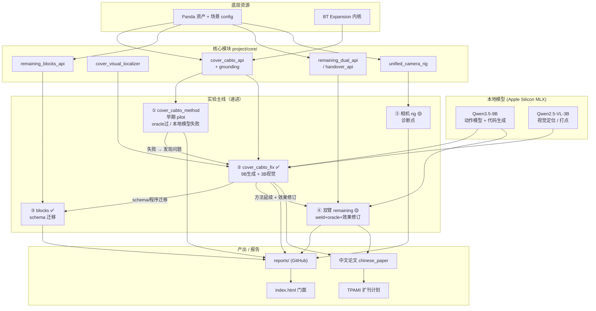

# CABTO 项目进展地图

> 生成时间：2026-10-10
> 工作目录：`/Users/yishuaicai/mywork/edps_cabto_exp`
> 一句话定位：这是 **CABTO（AAAI 2026《Context-Aware Behavior Tree Grounding for Robot Manipulation》）** 论文的复现 + 扩展工作目录。核心在做一件事——把论文里「半成品」的 **BT Grounding（行为树接地）流程**，在五个真实机器人操作任务上真正跑通，并沉淀可核验的证据。

## 图例

| 标记 | 含义 |
|---|---|
| ✅ | 已打通 / 通过 |
| 🟡 | 部分完成 / 进行中 |
| ❌ | 失败 / 未跑通 |

---

## 一、全景地图

```
CABTO（AAAI 2026）── 形式化 BT Grounding 问题（completeness + consistency）
        │
        ├── ① Cover 单臂（厨房三物配对放置）──────── ✅ 打通（唯一全程跑通到「严格无weld+视觉」的线）
        │      ├─ 早期方法 pilot ── 🟡 oracle 基线通过 / ❌ 本地模型+Qwen 闭环失败
        │      └─ 生成+视觉修复 ─── ✅ 9B 生成 7/7 · 3B 视觉 3/3 · holdout 2/2
        │
        ├── ② Blocks 单臂（积木堆叠）─────────────── ✅ 打通（schema 从 Cover 迁移，strict 无 weld + 视觉）
        │
        ├── ③ 三双臂（Pour / Handover / Storage）─── 🟡 部分（仍是 weld + oracle，仅做了「效果修订」）
        │
        ├── ④ 统一相机 rig + 视觉打点 ────────────── 🟡 相机兼容性通过，但打点是「诊断点」非「可执行点」
        │
        ├── ⑤ 论文实验复现（实验2 打点 + Stage3 闭环）─ 🟡 证据核验完，Qwen 打点精度是硬伤
        │
        ├── ⑥ 中文论文（ctexart）─────────────────── 🟡 17 页已编译通过，投稿前待完善
        │
        └── ⑦ TPAMI 扩刊规划 ─────────────────────── 🟡 扩刊报告已产出，尚未动手实施
```

### 依赖关系图（Mermaid）

> 展示「底层资源 → 本地模型 → 核心模块 → 实验主线 → 产出」的依赖层级，以及 **Cover → Blocks / 双臂** 的主线递进。



---

## 二、七条实验线详解

### 线 ① Cover 单臂 —— 最深入，经历了「失败 → 突破」

**目标**：厨房三物体配对放置（虾入碗、苹果上砧板、土豆入锅），走完整 CABTO 流程（LLM 提议动作模型 → VLM/代码生成策略 → 跨层修订）。

**两阶段尝试**：

| 阶段 | 目录 | 结果 |
|---|---|---|
| 早期方法 pilot | `outputs/cover_cabto_method/` | 🟡 会话模型候选 + Oracle 定位基线通过（7 动作、3/3 任务）；❌ 但**完全自主本地模型失败**（0.8B/3B 预算内提不出模型）、**本地 3B 代码生成失败**（重复/截断）、**Qwen 感知替换 Oracle 失败**（抓起虾但放置偏、0.8B 解析失败） |
| 生成 + 视觉修复 | `outputs/cover_cabto_fix/` | ✅ **突破**：真实本地 `Qwen3.5-9B` 生成动作库与代码（7/7 验收）；`Qwen2.5-VL-3B` 语义点 + 俯视 RGB 几何细化 + 高度先验；**视觉任务 3/3、holdout（±2mm）2/2、全程无 weld、最大放置误差 3.7mm** |

**关联脚本**（`project/`）：`propose_cover_factwise.py`（事实级提案）、`propose_cover_reasoned.py`（推理型 STRIPS 提案）、`refine_cover_model_library.py`（跨层细化）、`repair_cover_one_action.py`（单动作修复）、`finalize_cover_proposal.py`（预算后定稿）、`probe_cover_reference.py` / `probe_cover_generated_bt.py` / `probe_cover_cabto_negatives.py`。

> 关键结论：Cover 是**唯一**真正从「本地真实 9B 模型生成 + 无 weld + 视觉定位」全程打通的线，是整份工作的「标杆证据」。

---

### 线 ② Blocks 单臂 —— 验证了「跨任务 schema 迁移」

**目标**：积木堆叠与回位。

**结果**：✅ `strict_no_weld + Qwen 视觉`，动作模型 schema 直接**从 Cover 迁移**（`remaining_blocks_api.py`，`transfer_depth=1`），物理重放成功。证明了「接地好的动作库可跨任务复用」这一 CABTO 核心主张。

**关联脚本**：`probe_blocks_formal_loop.py`、`probe_blocks_generated_policy.py`、`single_arm_rebuilt.py`、`run_single_arm.py`。

---

### 线 ③ 三双臂任务（Pour / Handover / Storage）—— 卡在 weld + oracle

**目标**：双臂协作任务（端盆接球、空中交接、装箱上架）走 CABTO 迁移实验。

**结果**：🟡 部分完成。`outputs/remaining_cabto/` 记录：三双臂**仍是 `weld_assisted + oracle_geometry`**（抓持焊死、定位用真值），只做了「**效果修订**」——9B 模型根据真实执行反例提出 `extra_add/extra_del` 补丁（Pour 2 个、Handover 2 个、Storage 6 个），补丁后 `final_seed0/1` 全部通过。

**明确未做到**（`reproduce.txt` / `verification.json` 自述）：
- ❌ 双臂从空库自主提出模型
- ❌ Qwen 感知替换 Oracle
- ❌ 非 weld 接触抓持

**关联脚本**：`run_remaining_cabto.py`、`refine_remaining_frames.py`、`probe_held_basin_pour/codegen/collision.py`、`probe_handleless_generated_bt.py`、`probe_dual_lift_shelf/codegen.py`、`probe_dual_no_snap.py`、`probe_free_tray_packing.py`、`probe_smooth_held_basin_*.py`。

---

### 线 ④ 统一相机 rig + 视觉打点

**目标**：给五个场景装统一的腕部 + 全局相机，验证「诊断视觉」可行性。

**结果**：🟡 `unified_cameras/` 记录：相机 rig v1→v2→**v3**（腕部 `[0,-0.10,0.025]m` + 全局俯视），**5 场景兼容性运行通过，77 组同步关键帧、282 张原始图**；28 次 Qwen 打点诊断完成。

**但**：打点输出定位为「**诊断点**」而非「可执行抓取点」；Storage（箱内无视觉标记）、Pour（倾倒时臂挡盆）、Handover（双指接触区需标定）的视觉仍未解决。

**关联脚本**：`run_unified_camera_rig.py`、`probe_unified_camera_points.py`、`build_unified_camera_report.py`、`build_five_scene_pointing.py`。

---

### 线 ⑤ 论文实验复现（实验 2 打点 + Stage3 闭环）

**目标**：复现论文 Experiment 2（VLM 打点）与 Stage 3（单臂闭环）的证据。

**结果**（`paper_reproduction/`）：

| 后端 | 结果 | 像素误差 |
|---|---|---|
| Oracle | ✅ 2/2 | 对照真值 |
| Qwen2.5-VL-3B-Instruct-4bit（历史） | 🟡 12/20 | median 18.0 px |
| Qwen3.5-0.8B-4bit（本次补跑） | ❌ 2/20 | median 158.5 px |

Stage3 闭环：`oracle_replay` 复跑成功，`qwen_result.json` 历史闭环失败（VLM 定位瓶颈）。

> 关键结论：**VLM 打点精度是整个闭环的硬瓶颈**（0.8B 模型仅 2/20），也是论文「自纠正」卖点在代码里没能真正闭环的根因之一。

---

### 线 ⑥ 中文论文（ctexart）

**目标**：产出中文实证研究稿。

**结果**：🟡 `outputs/chinese_paper/` 已编译通过（**17 页 PDF、14 参考文献、6 图 7 表 1 算法**）。题目《执行证据驱动的机器人行为树接地与模型修订：五类操作场景的可复现研究》。数据口径：9 目标、43 动作实例、17 执行、113 转移；双臂 31 条训练见证中 21/31 全状态匹配，10 动作修订后 31/31。

**投稿前待办**：填真实作者/单位/贡献/资助声明、按目标期刊模板排版、若声称性能优势需补独立测试集与统一预算基线。

---

### 线 ⑦ TPAMI 扩刊规划（思考线）

**目标**：把 AAAI 版扩成 TPAMI 期刊稿。

**结果**：🟡 已产出详尽扩刊报告 `CABTO_TPAMI_extension_plan.md`，结论是「**可以投，但有条件**」——必须把「半成品自纠正闭环」做成「可学习 + 可验证 + 自进化」，用理论（NP-hardness + PAC 样本复杂度 + 收敛性）做差异化，且**要赶在 VASO/VersualRL 等 2026 新竞品抢发之前**。尚未动手实施。

---

## 三、贯穿各线的关键瓶颈

| # | 瓶颈 | 现状 | 影响 |
|---|---|---|---|
| B1 | **VLM 打点精度差** | 0.8B 仅 2/20（158px）、3B 12/20（18px） | 低层「策略」无法纯视觉闭环，是「自纠正」卖点没能真正闭环的根因 |
| B2 | **低层策略是脚本 + weld + oracle** | 三双臂全 weld，单臂依赖 oracle 初始 z / 载物跟踪 | 论文宣称的「自纠正闭环」在代码里是半成品 |
| B3 | **双臂任务未打通视觉/严格抓持** | Pour/Handover/Storage 定位 Oracle、抓持 weld | 离「真机自主」距离最远 |
| B4 | **理论缺失** | 只有 O(2^{3n}) 上界，无 NP-hardness/样本复杂度/收敛性 | TPAMI 期刊级贡献缺失 |
| B5 | **纯仿真、小规模、无真机** | 5 任务、有限 holdout（±2mm） | 无法声称泛化/落地 |

---

## 四、未完成项清单（= 下一步发力点）

- [ ] 双臂（Pour/Handover/Storage）从「weld + oracle」升级到「非 weld + Qwen 视觉」
- [ ] 双臂从「空库自主提出模型」（当前是工程参考模型初始化 + 效果补丁）
- [ ] VLM 打点精度提升（换更强 VLM / 结构化输出 / 多视角三角定位）
- [ ] 补理论：BT Grounding 的 NP-hardness、PAC 样本复杂度、收敛性
- [ ] 跨域/终身 grounding（当前每任务集从零开始）
- [ ] 中文论文投稿前完善（作者信息、独立测试集、预算基线）
- [ ] TPAMI 扩刊动手（挂 arXiv 占位 → 会议增量 → 期刊整合）

---

## 五、一句话总结

当前工作处在一个**「单臂已打通、双臂半成品、理论未动」**的阶段：**Cover/Blocks 单臂已经证明了「本地真实模型生成 + 无 weld + 视觉定位 + 跨任务迁移」这条路走通了**；三双臂卡在 weld+oracle、VLM 打点精度是硬瓶颈；中文论文和 TPAMI 扩刊计划都已成形，但都还差「最后落地的那几步」。
